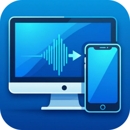
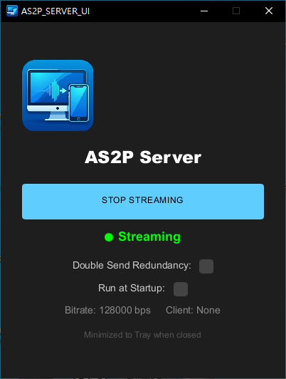
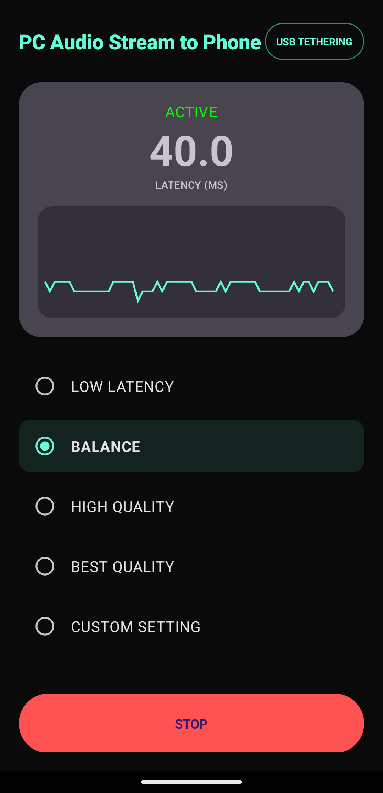

<p align="center">
  
</p>

<h1 align="center">PC Audio Stream to Phone (AS2P)</h1>

<p align="center">
  🎧 Low-latency, real-time audio streaming from your Windows PC to your Android device — with an adaptive jitter buffer and on-demand retransmission.
</p>

<p align="center">
  <strong>Free & Open Source · Rust server · Kotlin + C++ client · Opus @ 48 kHz stereo</strong>
</p>

<p align="center">
  <a href="https://www.rust-lang.org/"></a>
  <a href="https://developer.android.com/kotlin"></a>
  <a href="https://www.opus-codec.org/"></a>
  <a href="https://github.com/google/oboe"></a>
  <a href="https://github.com/anton1615/PC-Audio-Stream-to-Phone/releases"></a>
  <a href="./LICENSE"></a>
</p>

> [!IMPORTANT]
> **Best fit for:** people who want a no-frills PC → phone audio bridge — one button, one port, no account, no ads — and care about what happens under the hood when Wi-Fi gets rough.
>
> ⚠️ **Prototype status.** Treat this as a prototype-grade implementation rather than a hardened production audio transport. Use it on trusted networks only, and review release-signing, network exposure, and deployment assumptions before distributing builds broadly.
>
> The codebase was originally generated automatically by the Gemini CLI and has since seen substantial rework; the developer has not performed a line-by-line manual review of every internal logic path and security mechanism.

---

## 📑 Table of Contents

- [📸 Screenshots](#-screenshots)
- [💡 Why AS2P?](#-why-as2p)
- [🚀 Core Features](#-core-features)
- [🧭 Architecture Highlights](#-architecture-highlights)
- [🛠️ Technical Specifications](#️-technical-specifications)
- [💻 System Requirements & Setup](#-system-requirements--setup)
- [📖 How to Use](#-how-to-use)
- [❓ Troubleshooting](#-faq--troubleshooting)
- [🏗️ Build from Source](#️-build-from-source)
- [📄 License](#-license)

---

## 📸 Screenshots

<p align="center">
  
  
</p>

---

## 💡 Why AS2P?

There are several audio streaming solutions on the market (e.g., SoundWire, VBAN), but many are:

- 🔒 **Proprietary/Closed Source**: You don't know what's happening under the hood.
- 💰 **Paid/Subscription Based**: Features like high-quality audio or low latency are often locked behind a paywall.
- 🧩 **Over-complicated**: They often include complex routing features that users don't need for a simple PC-to-phone bridge.

**AS2P** is built to be a **Free, Open-Source, and Lightweight** alternative. It focuses on one thing and doing it well: **Streaming high-quality audio with minimal latency and maximum stability.**

---

## 🚀 Core Features

### On the wire — resilience first

- 📡 **Adaptive Jitter Buffer**: A five-state watermark controller. Latency rises only after an underrun is *confirmed*, and drains back once the link is stable — no permanent ratchet, no guesswork.
- 🔁 **On-Demand Retransmission**: A lost packet is requested back and resent with a retransmit marker. Costs *zero* extra bandwidth when nothing is lost — unlike blind duplicate-sending.
- 🧭 **Media-Timeline v9 Header**: Lateness is judged on a monotonic media clock (20 ms per tick), never on arrival time, so retransmissions are treated as exactly on time.
- 📈 **Link Statistics**: The client measures latency, late-packet %, and underruns, and reports them to the server; `--debug` prints them live alongside resend counters.
- 🎛️ **Tunable Presets**: `LOW_LATENCY` / `BALANCE` / `HIGH_QUALITY` / `BEST_QUALITY`, plus a full custom panel (bitrate, buffer, catch-up, PCM pre-decode target, PLC toggle).
- 🔊 **High Fidelity**: Opus @ 48 kHz stereo with PLC (Packet Loss Concealment) for artifact control on rough links.

### On Windows

- ⚡ **MMCSS "Pro Audio" Thread**: The capture thread registers with the Multimedia Class Scheduler, rescheduling slots that `HIGH_PRIORITY_CLASS` alone does not provide.
- 🧵 **Decoupled Workers**: Capture/encoding runs fully separated from network handling — Discord spikes and heavy traffic no longer jitter the 5 ms audio heartbeat.
- 🪟 **Tray-First UI**: Lightweight Slint window, run-at-startup support, < 0.1% CPU when hidden.
- 🎚️ **Anti-Clipping Transitions**: 10 ms linear fade-out/fade-in on start, stop, and device changes; automatic resampling of any source rate to 48 kHz.

### On Android

- 🔊 **Oboe Exclusive Mode**: Direct hardware access via C++ for the lowest round-trip latency, with decode off the audio callback on its own `nice -16` thread.
- 🌙 **Full Power Management**: `PARTIAL_WAKE_LOCK` + `MulticastLock` + audio focus — streaming, discovery, and playback all survive the screen turning off.
- 🔔 **Foreground Service**: MediaStyle notification with live playback controls; survives task managers and battery savers.
- 📉 **Dynamic Latency Chart**: Live latency readout and history graph in a Material 3 dark UI.
- 🔌 **USB Tethering Shortcut**: One-tap access to the system tethering screen; discovery broadcasts on *every* network interface so the cable link is found automatically.
- 📱 **Bluetooth-linked Lifecycle**: Stops the stream cleanly when Bluetooth headphones disconnect.

### Running the stream

- 🛰️ **Single Port (UDP 12345)** for all traffic — discovery, audio, control — for maximum firewall friendliness.
- 🔍 **Auto-Discovery**: The client broadcasts and links instantly; no IP typing.
- 💾 **Smart Persistence**: Remembers your last preset.
- 🧠 **Smart Disconnect**: The server returns to listening state after 5 s of silence and can be re-found without a restart.

---

## 🧭 Architecture Highlights

### 1. The v9 packet header separates two clocks

```
 0..10   "AS2P_AUDIO"
10..18   media_tick    u64   monotonic frame counter (20 ms per tick)
18..26   send_ts_ms    u64   sender wall clock
26..34   flags         u64   bit0 = retransmission marker
34..38   seq           u32   transmit order
38..     opus payload
```

The receiver judges lateness on `media_tick`, never on arrival time. A retransmitted packet is *old* by arrival time but exactly *on time* in the media timeline — mixing those two notions is the classic bug this header exists to prevent.

### 2. Reliability is requested, not assumed

When the decode thread sees a gap between expected and received tick, it asks the sender to resend the missing ticks (capped at 8 per gap). The sender keeps a 128-packet cache and resends with the retransmission flag set, so the receiver can account for it correctly. The legacy blind double-send remains available as a toggle for very lossy links.

### 3. Five states keep the buffer honest

| State | Enters when | Leaves when |
|-------|-------------|-------------|
| `Normal` | steady state | an underrun is seen → `PreHolding` |
| `PreHolding` | underrun seen | 500 ms clean → back to `Normal`; second underrun → `Holding` |
| `Holding` | instability *confirmed* | buffered + stable 3 s → `PreEmptying` |
| `PreEmptying` | link recovered | 2 s clean → step the watermark down, or `Normal` at base |
| `Emptying` | backlog dropped | occupancy back at watermark → `PreEmptying` |

The confirm/release windows are what stop a single stray underrun from permanently raising your latency — and the ceiling grows *relative to measured occupancy*, so it can absorb a bad link without ratcheting upward forever. The controller is pure logic in [`adaptive_buffer.h`](android/app/src/main/cpp/adaptive_buffer.h), unit-testable on any host.

### 4. The audio thread is treated like the real-time thread it is

On Windows, the capture thread registers as a *Pro Audio* MMCSS task. On Android, decoding happens on a dedicated thread at `nice -16`, and the Oboe callback only ever copies from an already-decoded PCM buffer — no decoding, no allocation, no network on the audio path.

### 5. Everything survives the screen turning off

Wake lock (CPU), multicast lock (discovery broadcasts), audio focus (correct behavior when other apps take sound), and a foreground service (process priority) — the four pieces Android takes away unless you ask for each explicitly.

---

## 🛠️ Technical Specifications

| Layer | Technology |
|-------|------------|
| **Server** | Rust · `cpal` capture (WASAPI loopback) · `rubato` resampling · `audiopus` encode · Slint UI · tray-icon |
| **Client** | Kotlin + Jetpack Compose UI · C++ native engine via JNI · `Oboe` output (exclusive/low-latency) · Opus decode · PLC |
| **Protocol** | AS2P v9 — custom UDP protocol on port 12345, 38-byte audio header, retransmission + client stats messages |
| **Codec** | Opus CBR, 48 kHz stereo, 20 ms frames (highly recommended: set Windows output to 48 kHz) |

---

## 💻 System Requirements & Setup

**Windows (server)**: Windows 10/11 x64.

**Android (client)**: Android 9.0+ (API 28); recommended Android 13–15. Fully supports 16 KB page-size environments.

### First-time setup

1. **Audio format**: Windows Sound Settings → set your default output device to **48000 Hz** (server resamples automatically, but native 48 kHz is cleanest).
2. **Firewall**: allow UDP port **12345** inbound and outbound on the PC.

---

## 📖 How to Use

### 1. Launch the server

Run `server.exe` — the console is hidden by default for a clean experience. For troubleshooting, run with logs:

```powershell
./server.exe --debug            # full connection + audio logs, incl. client link stats
./server.exe --drop-rate 0.1     # simulate 10% packet loss to stress the buffer
```

### 2. Connect the client

Open the Android app and tap **CONNECT** — it broadcasts on all interfaces and links instantly. You can switch apps or turn the screen off; the stream keeps running until you tap **STOP**.

### 3. Pick a preset

Choose `LOW_LATENCY`, `BALANCE`, `HIGH_QUALITY`, or `BEST_QUALITY` based on your link — the preset is remembered between sessions. The **CUSTOM SETTING** panel exposes every knob (bitrate, buffer size, catch-up threshold, PCM pre-decode target, PLC) if you want to tune it yourself.

### 4. USB tethering (no Wi-Fi needed)

1. Connect the phone via USB.
2. Tap **USB TETHERING** in the app header and enable tethering in the system screen.
3. Windows brings up the tethered adapter automatically — click **CONNECT**; discovery runs on every interface, so the cable link is found even when Wi-Fi/mobile data is the default route.
4. Ensure UDP 12345 is allowed and the tethered adapter's network profile is **Private** on Windows — a **Public** profile silently drops the discovery reply.

> [!TIP]
> Windows labeling the tethered adapter "No internet access" is expected and harmless — AS2P only needs local connectivity.

---

## ❓ FAQ / Troubleshooting

- **Audio is choppy / occasionally pauses** → try a higher preset (`HIGH_QUALITY`), or `CUSTOM SETTING` to raise the buffer size a step. The adaptive buffer raises itself once an underrun is confirmed; on a persistently bad link, starting higher avoids the initial hiccups.
- **Client can't find the server** → check the firewall (UDP 12345), check that the PC and phone are on the same network, and set any tethered adapter's network profile to **Private**.
- **No sound at all** → the server captures the *default output device*; make sure the PC is actually playing through it, and set the device to 48 kHz.
- **Rapid preset switching drops audio** → the server can lag behind quick reconfigurations; wait a few seconds or tap **STOP** then **CONNECT**.
- **Microsoft Defender flags `server.exe`** → unsigned network+capture executables occasionally trigger this; builds are compiled here in CI from open source.
- **Server window shows a white rectangle after a long run** → known rendering quirk in the prototype; restart or minimize/restore.

---

## 🏗️ Build from Source

```bash
# Server: build + tests
cd server
cargo test
cargo build

# End-to-end protocol check against a running server (localhost)
python tests/protocol_smoke.py 12345

# Android APK
cd android
java -cp gradle/wrapper/gradle-wrapper.jar org.gradle.wrapper.GradleWrapperMain :app:assembleDebug

# Jitter buffer controller — pure logic, runs on the host
g++ -std=c++17 -I android/app/src/main/cpp \
    android/app/src/test/cpp/adaptive_buffer_test.cpp -o ab_test && ./ab_test
```

The Android build needs `local.properties` pointing at the Android SDK and `NDK 25.1.8937393`; Oboe and Opus are fetched by CMake on first build.

---

## 📄 License

Licensed under the [MIT License](LICENSE).
